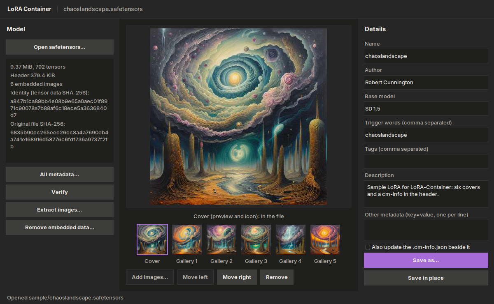

LoRA-Container
==============

A method, with example tools, for containing an image gallery and metadata in a LoRA so that it is self-contained, without breaking the LoRA.

Concept by Robert Cunnington (ReLiC71), first discussed November 2025. Gallery format and tools built 13 November 2026 with Claude (Anthropic). Licensed under Apache 2.0.

The idea
--------
A .safetensors file starts with a JSON header that has a free-form `__metadata__` block of string values. Put the cover image and gallery in there, as base64 JPEGs. The images then travel with the model: they cannot be lost, separated or renamed away. Tensor data is not touched, and loaders that do not know about the covers simply ignore them.

Format
------
All keys live in `__metadata__`, and every value is a string. The full description is in [SPEC.md](SPEC.md).

| key | value |
|---|---|
| `cover_format` | `"1"` |
| `cover_count` | number of covers, e.g. `"6"` |
| `cover_1` ... `cover_N` | base64 JPEG. `cover_1` is the cover (preview and icon); the rest are the gallery |
| `model_sha256_original` | SHA-256 of the whole file before anything was embedded |
| `tensor_data_sha256` | SHA-256 of everything after the header: the stable identity |
| `cm_info` | optional: a Stability Matrix `.cm-info.json`, carrying the original hashes |

Practical notes
---------------
- The convention is one cover and five gallery images. At the default 512 px and JPEG quality 46, six add about 0.3 MiB.
- Editing the header changes the whole-file hash, which breaks hash lookups on sites such as Civitai. `tensor_data_sha256` does not change, and `model_sha256_original` and the embedded cm-info keep the hash the model is known by.
- Tensor data is never changed. Every write is checked against the tensor hash before it replaces anything.
- It can be undone. `strip` removes everything that was added and says whether the result is byte for byte the original file.

Install
-------
Python 3.8 or later.

    pip install .

That installs Pillow, the only dependency, and two commands: `lora-container` and `lora-container-gui`. Or run the two .py files as they are, with Pillow installed. Two extras are optional: `blake3` (adds BLAKE3 to the cm-info hashes) and `tkinterdnd2` (lets you drop files onto the window).

The window
----------
    lora-container-gui            (or: python3 lora_container_gui.py)

Open a .safetensors and Save as: that is all, if the images and details sit beside the model under the usual names (`NAME.preview.jpeg`, `NAME.gallery1.jpeg` to `NAME.gallery5.jpeg`, `NAME.cm-info.json`), because they are picked up when the file is opened. Otherwise add up to six images and fill in the details by hand. The first image is the cover. Opening a file that already has covers shows them, so the same window is the viewer. It can also verify a file, extract its images, and remove the embedded data again. It uses tkinter, which comes with Python on Windows and macOS; on Linux it may be a separate package (`python3-tk`).

The command line
----------------
    lora-container embed model.safetensors cover.png g1.png g2.png -o out.safetensors --author Name --trigger-words "one, two"
    lora-container meta out.safetensors --tags "style, landscape" -m key=value --force
    lora-container show out.safetensors
    lora-container verify out.safetensors
    lora-container extract out.safetensors outdir --sm-names
    lora-container strip out.safetensors -o plain.safetensors
    lora-container batch folder --out folder2

- Nothing is overwritten unless you say so: give `-o OUT`, or `--force` to change a file in place.
- `--dry-run` checks everything and reports, and writes nothing.
- `embed` with no images named uses `NAME.preview.jpeg`, `NAME.gallery1.jpeg` and so on from beside the model.
- `embed --replace` changes the covers of a file that already has them.
- `--title`, `--author`, `--base-model`, `--trigger-words`, `--tags` and `--description` go into the embedded cm-info. `-m key=value` sets a plain metadata key.
- `--sidecar` also updates the `.cm-info.json` beside the output and adds a numbered `Changelog` line.
- `batch` handles every model in a folder. For `NAME.safetensors` it takes `NAME.preview.jpeg` then `NAME.gallery1.jpeg` and so on (the Stability Matrix names), or the images in a folder called `NAME`, plus `NAME.cm-info.json` and an optional `NAME.meta.json` of extra fields.
- Exit codes: 0 done, 1 a check failed, 2 bad input, 3 refused because it would overwrite.

Tests
-----
    pip install pytest
    python3 -m pytest

`viewer.html` is the first proof of concept, kept as it was: a single page that shows the covers of files dropped onto it.

Related work
------------
Putting an image in a safetensors header is not new, and this convention builds on it:
- Stability AI's ModelSpec (https://github.com/Stability-AI/ModelSpec) defines `modelspec.thumbnail`: one very small (256x256 recommended) data-URI image.
- A `ssmd_cover_images` key, a JSON list of base64 images, is read by some model-manager code. Its origin and date have not been established here.
- A Civitai article proposing `sd.artifact.v1` (https://civitai.com/articles/24796, January 2026) suggests an embedded preview image in a self-describing block.

What this repository adds is a plain key-per-cover layout, a two-hash identity scheme that survives header edits, an embedded cm-info, an undo route that can be checked, and working tools.

Status
------
Version 1. The only model file here is `sample/chaoslandscape.safetensors`, a small SD 1.5 LoRA (trigger word `chaoslandscape`) trained by the author on his own generated images, with six covers and a cm-info embedded. Open it in the window to see them. Stability Matrix does not read embedded covers at the time of writing; it uses loose preview files.
